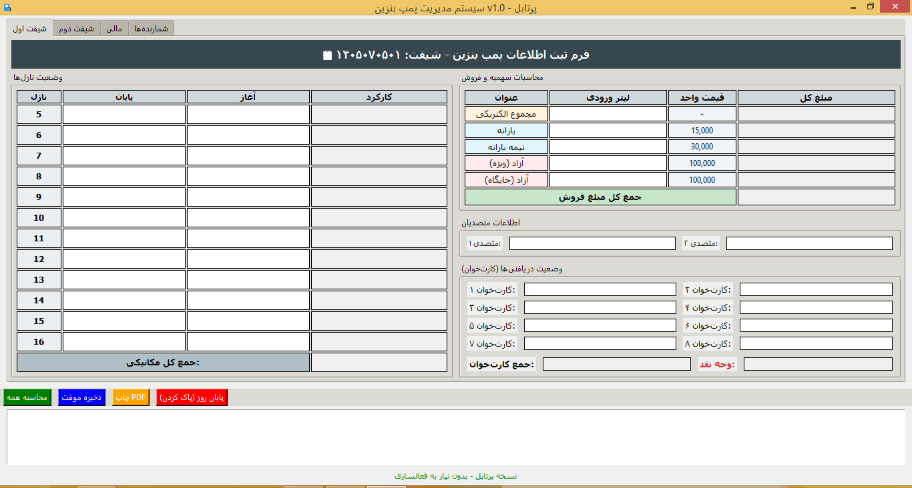

[English](README.md) · **فارسی**

<div dir="rtl">

# مدیریت پمپ بنزین

یک برنامه دسکتاپ ویندوزی که کار حسابرسی دستی شیفت‌های پمپ بنزین را جایگزین می‌کند. کاملاً آفلاین اجرا می‌شود، گزارش PDF فارسی چاپی تولید می‌کند، و یک سیستم لایسنس قفل‌شده به سخت‌افزار دارد.

| | قبل | بعد |
|---|---|---|
| زمان هر شیفت | ~۶۰ دقیقه | ~۵ دقیقه |
| خطای محاسباتی | رویداد روزانه | صفر |
| خروجی | برگه دست‌نویس | PDF فارسی آماده چاپ |

روند قدیمی فقط کند نبود. هر شیفت، حسابرس قیمت را در لیتر ضرب می‌کرد، جمع دوازده نازل را حساب می‌کرد، خوانش پایان را از آغاز کم می‌کرد، و مبالغ کارت‌خوان را با فروش تطبیق می‌داد — همه با دست، روی کاغذ، زیر فشار زمان. یک رقم در جای اشتباه یعنی یک جمع اشتباه که کسی تا موقع رسیدگی به دفاتر متوجه نمی‌شود.

برنامه این محاسبات را انجام می‌دهد. حسابرس فقط خوانش خام را وارد می‌کند.



---

## مشکل

پمپ بنزین‌ها در ایران موظفند طبق قانون شرکت فرآورده‌های نفتی، سند فیزیکی و چاپی هر شیفت را نگه دارند. این محدودیت، یک برنامه وب معمولی با دیتابیس را از معادله حذف می‌کند. هر عدد باید در نهایت روی کاغذ برود، امضا شود، و بایگانی شود.

روند قدیمی:

- حسابرس خوانش نازل‌ها، قیمت‌های سوخت، و جمع کارت‌خوان‌ها را روی فرم چاپی پر می‌کند.
- هر ضرب (قیمت × لیتر برای سه نوع سوخت)، هر جمع (۱۲ نازل × دو شیفت)، هر تفریق (خوانش پایان منهای آغاز)، و تطبیق نهایی کارت‌خوان با نقدی، با دست یا ماشین حساب جیبی انجام می‌شود.
- خوانش پایانی هر شیفت باید چشمی از یک برگه به برگه‌ی شیفت بعدی کپی شود.
- یک لغزش محاسباتی یعنی یک جمع اشتباه، و اغلب یعنی از نو نوشتن کل برگه.

هر شیفت می‌توانست یک ساعت یا بیشتر طول بکشد. با دو شیفت در روز، این یعنی زمان واقعی که هر روز در هر جایگاه هدر می‌رفت. و نرخ خطا صفر نبود — یک گلایه‌ی روتین از طرف مدیریت بود.

## این برنامه چه‌کار می‌کند

- **ثبت شیفت.** خوانش آغاز و پایان نازل‌ها، قیمت‌های سوخت (یارانه، نیمه‌یارانه، آزاد)، نام متصدیان، و جمع کارت‌خوان‌ها.
- **محاسبات درست، همیشه.** تمام تفریق‌ها، ضرب‌ها، و جمع‌ها توسط برنامه انجام می‌شود. حسابرس فقط خوانش‌ها را وارد می‌کند و بقیه با برنامه است. بدون ماشین حساب، بدون حساب ذهنی، بدون انتقال دستی بین ستون‌ها.
- **انتقال خودکار بین شیفت‌ها.** خوانش پایان شیفت اول، خودکار در فیلد آغاز شیفت دوم قرار می‌گیرد. بدون تایپ دوباره، بدون خطا، بدون جا افتادن خوانش.
- **خروجی PDF.** گزارش چهارصفحه‌ای (شیفت اول، شیفت دوم، خلاصه مالی، شمارنده‌ها). متن فارسی، تاریخ شمسی، چیدمان راست‌به‌چپ. نام فایل از تاریخ شیفتی که کاربر وارد می‌کند ساخته می‌شود تا بایگانی یکدست باشد.
- **ذخیره موقت.** حسابرس شیفت بعد می‌تواند برنامه را ببندد و کار را از همان‌جا که قبلی رها کرده ادامه بدهد.
- **لایسنس قفل‌شده به سخت‌افزار.** هر مشتری یک فایل لایسنس می‌گیرد که به شناسه سخت‌افزاری سیستمش گره خورده. هیچ بررسی اینترنتی لازم نیست.

یک نکته درباره صحت: **خطای محاسباتی حذف شده است.** تمام عملیات ریاضی را برنامه انجام می‌دهد. آنچه باقی می‌ماند احتمال خطای ورودی است — اگر حسابرس ۱۲۳۴ را جای ۱۲۳۴۵ تایپ کند، برنامه نمی‌تواند تشخیص بدهد. به همین دلیل خروجی چاپی هنوز بخشی از روند است: حسابرس قبل از امضا آن را می‌خواند.


---

## ساختار فنی

| لایه | انتخاب | دلیل |
|---|---|---|
| رابط کاربری | Tkinter | همراه پایتون نصب می‌شود. هیچ runtime خارجی ندارد. روی هر ویندوز ۷ به بالا بدون نصب چیزی اجرا می‌شود. |
| PDF | ReportLab + arabic_reshaper + bidi | شکل‌دهی مطمئن متن فارسی و چیدمان راست‌به‌چپ در PDF. |
| ذخیره‌سازی | فایل‌های JSON روی دیسک | بدون سرور دیتابیس. متناسب با سناریوی آفلاین و تک‌دستگاه. |
| لایسنس | شناسه سخت‌افزاری سفارشی (SHA-512) + فایل امضاشده | مشتری با ارسال یک شناسه کوتاه فعال‌سازی می‌کند. بدون سرور. |
| بسته‌بندی | PyInstaller (onedir) | پوشه پرتابلی می‌سازد که بدون نصب پایتون اجرا می‌شود. |

### چرا دیتابیس نه

مشتری صراحتاً سند چاپی خواسته بود. دیتابیس پاسخ اشتباهی به مشکل واقعی می‌بود — فقط یک منبع حقیقت دوم اضافه می‌کرد. در عوض، برنامه یک PDF مستقل تولید می‌کند که مستقیم به چاپگر می‌رود، و نام فایل تاریخ شیفت را برای بایگانی آسان رمزگذاری می‌کند.

یک لایه‌ی داده‌ی حداقلی (فایل‌های JSON در `data/`) وجود دارد تا اگر روزی مشتری تاریخچه‌ی قابل جستجو خواست، مسیر مهاجرت آماده باشد.

### چرا آفلاین

پمپ بنزین‌های هدف اغلب اینترنت ناپایدار دارند. هر وابستگی به سرور راه دور یعنی بار پشتیبانی اضافه. کل برنامه بدون اتصال شبکه اجرا می‌شود.


---

## ساختار مخزن

```
.
├── main.py                     # نقطه ورود (نسخه با لایسنس)
├── build.py                    # بیلد بسته مشتری با لایسنس
├── build_no_license.py         # بیلد بسته پرتابل بدون لایسنس
├── components/                 # فرم‌ها و خروجی PDF
│   ├── form1_component.py
│   ├── form2SH_component.py
│   ├── form2_component.py
│   ├── form3_component.py
│   └── pdf_exporter.py
├── utils/
│   └── persian_utils.py        # ابزارهای شکل‌دهی متن فارسی
├── asset/                      # لوگوی splash
├── fonts/                      # فونت وزیر (SIL OFL)
├── docs/                       # تصاویر
└── support-tools/              # ابزارهای فروشنده (به مشتری داده نمی‌شود)
    ├── license_admin_panel.py  # داشبورد مشتری و لایسنس
    ├── license_generator.py    # ساخت فایل‌های .license
    └── license_manager.py      # لایه SQLite برای پنل ادمین
```

پوشه `support-tools/` بخشی از نسخه مشتری نیست. این سمت داخلی برای صدور و پیگیری لایسنس‌هاست.

---

## بیلد

پیش‌نیاز: پایتون ۳.۹+ و PyInstaller.

```bash
pip install pyinstaller jdatetime reportlab pillow arabic-reshaper python-bidi
```

دو هدف بیلد:

```bash
# بیلد مشتری با لایسنس — برای اجرا به فایل .license نیاز دارد
python build.py

# بیلد پرتابل — بدون لایسنس، بدون فعال‌سازی
python build_no_license.py
```

هر اسکریپت یک پوشه آماده تحویل می‌سازد:

```
GasStationManager_Client_YYYYMMDD/
├── run.bat
├── readme.txt
└── GasStationManager/
    ├── Gas Station Management.exe
    ├── _internal/
    ├── fonts/
    ├── asset/
    └── data/
```

مشتری می‌تواند `asset/logo.png` و `fonts/Vazir.ttf` را بدون دست زدن به فایل اجرایی با مال خودش عوض کند.

---

## مدل لایسنس

هر نصب، یک شناسه سخت‌افزاری از نام کامپیوتر، آدرس MAC، پردازنده، تعداد هسته، و سریال هارد می‌سازد و با SHA-512 هش می‌کند. مشتری این شناسه را کپی می‌کند، برای پشتیبانی می‌فرستد، و یک فایل `.license` امضاشده می‌گیرد که به همان دستگاه گره خورده و تاریخ انقضا دارد.

این یک انتخاب آگاهانه بود: مشتریان هدف کسب‌وکارهای کوچکی هستند که ممکن است اینترنت پایدار نداشته باشند، پس هر فعال‌سازی وابسته به تماس با سرور شکننده می‌بود. مدل مبتنی بر فایل آفلاین کار می‌کند و در همان دستگاه از نصب مجدد جان سالم به در می‌برد.

---

## زمینه

برای یک مشتری واقعی در حوزه پمپ بنزین ساخته شد. چند جایگاه به‌صورت روزانه از آن استفاده می‌کنند. روند کاغذی قدیمی در آن جایگاه‌ها کنار گذاشته شده است، همراه با خطاهای محاسباتی روزانه‌ای که با آن می‌آمد.

برنامه را خودم طراحی و پیاده‌سازی کردم و از ابزارهای هوش مصنوعی به‌عنوان بخشی از روند کدنویسی استفاده کردم. معماری، تعامل با مشتری، مدل داده، چیدمان PDF، و سیستم لایسنس، تصمیماتی بودند که در جریان پروژه گرفته شدند، نه تولیدشده.

---

## پشته فناوری

Python 3 · Tkinter · ReportLab · SQLite (سمت فروشنده) · PyInstaller · jdatetime · arabic-reshaper · python-bidi

---

## لایسنس

کد منبع برای بررسی نمونه‌کار ارائه شده است. اجزای شخص ثالث لایسنس خودشان را دارند (فونت وزیر: SIL OFL 1.1؛ ReportLab: BSD).

</div>