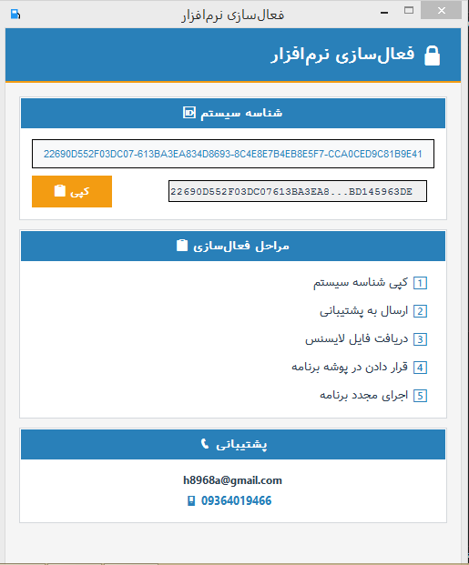

**English** · [فارسی](README.fa.md)

# Gas Station Manager

A Windows desktop app that replaces the manual shift-audit paperwork in fuel stations. Runs offline, produces print-ready Persian PDF reports, and ships with a hardware-locked license system.

| | Before | After |
|---|---|---|
| Time per shift | ~60 minutes | ~5 minutes |
| Arithmetic errors | daily occurrence | eliminated |
| Output | handwritten sheet | print-ready Persian PDF |

The old workflow was not just slow. Every shift, the auditor multiplied price by liters, summed twelve nozzles, subtracted ending counters from starting counters, and reconciled card-reader totals — all by hand, on paper, under time pressure. One digit in the wrong place meant a wrong total that nobody noticed until the books were checked.

The app does the arithmetic. The auditor only enters the raw readings.


---

## The problem

Fuel stations in Iran are required by the national petroleum products company to keep **physical, printed records** of every shift. That constraint rules out a normal web app with a database. Every number has to end up on paper, signed, and archived.

The old workflow:

- Auditor fills out nozzle readings, fuel prices, and card-reader totals on a printed form.
- Every multiplication (price × liters for three fuel types), every sum (12 nozzles × two shifts), every subtraction (end reading − start reading), and the final card-vs-cash reconciliation is done by hand or with a pocket calculator.
- The next shift's starting readings have to be copied from the previous shift's ending readings — by eye, from one sheet to another.
- A single arithmetic slip means a wrong total, and often means redoing the entire sheet.

One shift could take an hour or more. With two shifts a day, that is real time lost per station, per day. And the error rate was not zero — it was a routine complaint from management.

## What this app does

- **Shift entry.** Nozzle start/end readings, fuel prices (subsidized, semi-subsidized, free-market), operator names, and card-reader totals.
- **Correct arithmetic, every time.** All subtractions, multiplications, and sums are computed by the app. The auditor enters readings, the app does the rest. No calculator, no mental math, no manual carry-over between columns.
- **Financial reconciliation.** Cash and card-reader (POS) totals are computed automatically, compared against the fuel sales value, and any discrepancy is shown explicitly. The auditor no longer has to reconcile cash vs. POS by hand.
- **Automatic handoff between shifts.** Shift 1's end readings are copied into Shift 2's start fields. No retyping, no drift, no missed readings.
- **PDF output.** A four-page report (Shift 1, Shift 2, financial summary, counters). Persian text, Jalali dates, RTL layout. File name is generated from the shift date the user enters, so archiving is consistent.
- **Temporary save.** The next auditor can close the app and pick up where the previous one left off.
- **Hardware-locked license.** Each customer gets a license file bound to their machine's hardware ID. No internet check required.


A note on accuracy: **calculation errors are eliminated.** The app does every arithmetic operation. What remains is the possibility of a wrong *input* — if the auditor types 1234 instead of 12345, the app cannot detect that. That is why the printed PDF is still part of the workflow: the auditor reads it before signing.

---

## How it is put together

| Layer | Choice | Reason |
|---|---|---|
| UI | Tkinter | Ships with Python. No external runtime. Runs on any Windows 7+ machine without installing anything. |
| PDF | ReportLab + `arabic_reshaper` + `bidi` | Reliable Persian text shaping and RTL layout inside a PDF. |
| Persistence | JSON files on disk | No database server. Fits the offline, single-machine use case. |
| Licensing | Custom hardware ID (SHA-512) + signed license file | Customer activates by sending a short ID. No server involved. |
| Packaging | PyInstaller (`onedir`) | Produces a portable folder that runs without Python installed. |

### Why no database

The customer explicitly asked for printed records. A database would have been the wrong answer to the actual problem — it would just have added a second source of truth. Instead, the app writes a self-contained PDF that goes straight to the printer, and the file name encodes the shift date for easy archiving.

A minimal data layer is in place (JSON files in `data/`), so if the customer ever asks for a searchable history, the migration path exists.

### Why offline

Fuel stations in the target market often have unreliable internet. Any dependency on a remote server would have been a support burden. The whole app runs without a network connection.

---

## Repository layout

```
.
├── main.py                     # Entry point (licensed build)
├── build.py                    # Build the licensed client package
├── build_no_license.py         # Build the portable, no-license package
├── components/                 # UI forms and PDF exporter
│   ├── form1_component.py
│   ├── form2SH_component.py
│   ├── form2_component.py
│   ├── form3_component.py
│   └── pdf_exporter.py
├── utils/
│   └── persian_utils.py        # Persian text shaping helpers
├── asset/                      # Logo used in the splash screen
├── fonts/                      # Vazir font (SIL OFL)
├── docs/                       # Screenshots
└── support-tools/              # Seller-side tools (not shipped to customers)
    ├── license_admin_panel.py  # Customer & license dashboard
    ├── license_generator.py    # Creates .license files
    └── license_manager.py      # SQLite layer for the admin panel
```

`support-tools/` is not part of the customer build. It is the internal side used to issue and track licenses.

---

## Build

Requirements: Python 3.9+, PyInstaller.

```bash
pip install pyinstaller jdatetime reportlab pillow arabic-reshaper python-bidi
```

Two build targets:

```bash
# Licensed client build — requires a valid .license file to run
python build.py

# Portable build — no license, no activation
python build_no_license.py
```

Each script produces a ready-to-ship folder:

```
GasStationManager_Client_YYYYMMDD/
├── run.bat
├── readme.txt
└── GasStationManager/
    ├── Gas Station Management.exe
    ├── _internal/
    ├── fonts/
    ├── asset/
    └── data/
```

The customer can replace `asset/logo.png` and `fonts/Vazir.ttf` with their own without touching the executable.

---

## License model

Each installation generates a hardware ID from the machine's name, MAC address, CPU, core count, and disk serial number, hashed with SHA-512. The customer copies this ID, sends it to support, and receives a signed `.license` file that is bound to that machine and carries an expiry date.

### Activation flow

When the customer runs the executable for the first time, the app opens the activation window below. It displays the machine's hardware ID and a **Copy** button.



The steps are:

1. The customer runs `Gas Station Management.exe`. The activation window appears and shows the hardware ID of that specific machine.
2. The customer clicks **Copy** and sends the ID to support (email or messaging app — no internet connection is required on the app side).
3. Support generates a signed `.license` file bound to that ID and sends it back.
4. The customer **must rename the file to `gas_station.license`** and place it inside the `GasStationManager` folder — the same folder that contains the `.exe`.
5. On the next launch, the app validates the license file and opens normally. No internet check, no login, no activation code to retype.

> **Note for reviewers:** the license file name matters. If the file is not named exactly `gas_station.license` and is not placed next to the executable, the app will treat the machine as unlicensed and refuse to start. This is intentional — it makes the license file easy to spot and easy to back up.

The seller side uses a small internal tool to generate and track these license files:


This was a deliberate choice: the target customers are small businesses that may not have reliable internet, so any phone-home activation would be brittle. A file-based model works offline and survives re-installations on the same machine.

---

## Context

Built for a real client in the fuel-station sector. Used daily by several stations. The original paper-based workflow has been retired in those stations, along with the daily arithmetic errors that came with it.

I designed and implemented the app myself, using AI tools as part of the coding workflow. The architecture, the interaction with the client, the data model, the PDF layout, and the license system were all decisions made during the project, not generated.

---

## Tech stack

Python 3 · Tkinter · ReportLab · SQLite (seller-side) · PyInstaller · jdatetime · arabic-reshaper · python-bidi

---

## License

Source code is provided for portfolio review. Third-party components keep their own licenses (Vazir font: SIL OFL 1.1; ReportLab: BSD).